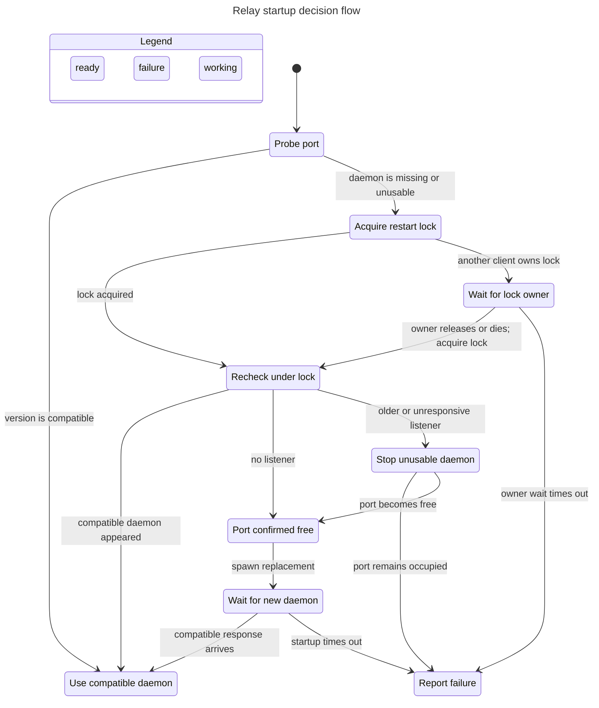
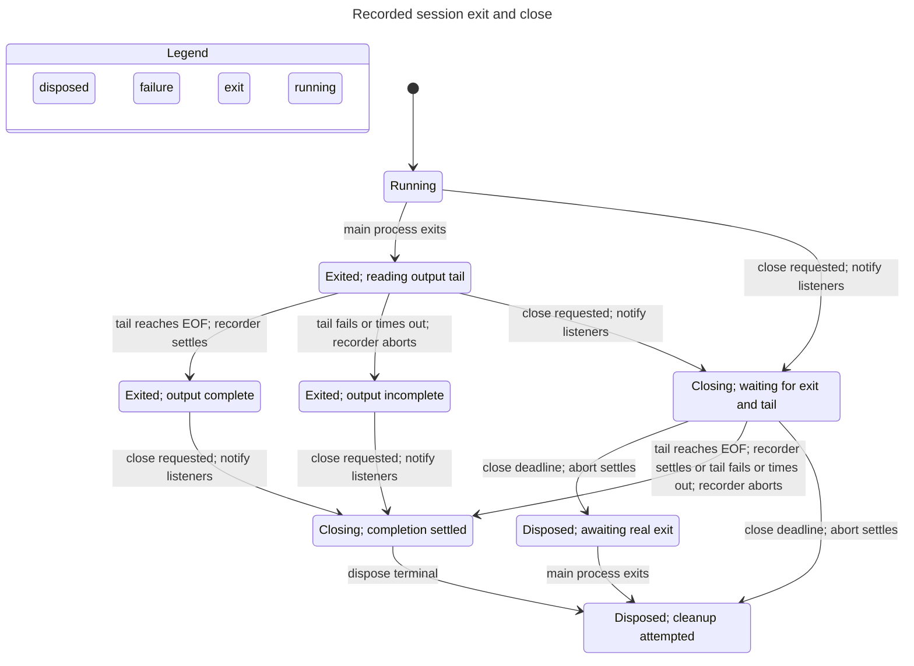
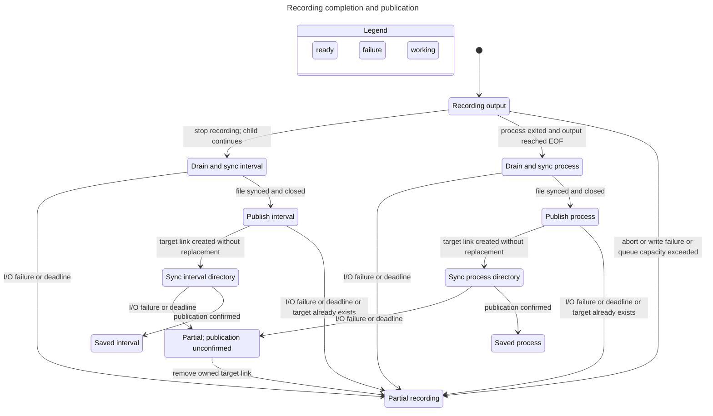

# Starter models and statecharts

These models prepare later formal verification of the mapped source revision. TLC exhaustively explores each finite model. No refinement proof connects these models to TypeScript, operating-system callbacks, or filesystem behavior. No model checks a temporal liveness property or assumes scheduler fairness. `NoDeadlock` alone does not prove eventual completion; terminal stuttering is intentional.

Pele `1.9.0` renders the generated Mermaid statecharts as SVG. [Pele API](https://pele.run/api). The `.mmd` sources remain editable, and the view modules define labels and projection. Model sources, configurations, views, TLC reports, and rendered files are retained here.

## Checked model boundaries

| Model | State variables and source correspondence | Checked scope | Excluded behavior |
| --- | --- | --- | --- |
| [Relay](models/Relay.tla) | Client phase, port category, lock result, mutation history; [ensureRelayRunning](../../src/cli.ts#L2221) | One startup request, both probe outcomes, lock acquisition, waiting and timeout, free/stuck port, readiness success or timeout | Bakery ticket selection, filesystem enumeration and dead-record cleanup, simultaneous clients, concurrent daemon-stop, PID ownership, bind races, changing port owner after re-probe |
| [Session](models/Session.tla) | Session resource state, process state, processed output completion, closure notices and cleanup attempt; [close](../../src/session.ts#L1090), [completion](../../src/session.ts#L393) | One recorded session after successful creation, exit before/after close, EOF/failure/deadline, repeated close | Plain sessions, native write queues, descendant process groups, listener reentrancy, exact timing, filesystem errors, shared-promise identity |
| [Recorder](models/Recorder.tla) | Recording state, extent, queue units, file sync, target ownership and directory sync; [Recorder](../../src/recording.ts#L52) | One prepared recorder, up to two payload units plus one control unit, drain, stop/process finish, publish conflict, abort, owned-link cleanup | Arbitrary byte sizes, event contents/order, exact timestamps, concurrent filesystem mutation, delayed link after timeout, inode reuse, crashes, export workers |

The Relay model allows the port observation to change between the first probe and the locked re-probe. It then assumes no competing mutation. `MutationHasLock` records the request's acquired-lock flag; it does not establish real mutual exclusion. Waiting transitions back to the locked re-probe after acquisition. Successful and failed operations release their lock before returning or reporting failure. The new `FinishedReleasesLock` invariant checks that abstraction. The bakery algorithm itself needs a separate multi-client model; this chart does not prove its mutual exclusion.

The Session model's EOF means `finishCompletion()` has processed EOF after awaiting exit. It does not claim that the OS cannot emit EOF before process exit. Recorder settlement and abort are collapsed into transitions. Cleanup means an attempt, not guaranteed deletion. Close-deadline transitions assume abort settles; they do not prove a five-second wall-clock bound.

The Recorder model starts after preparation. A foreign target may already have appeared by then. Hard-link creation, directory sync and state publication are separate actions. Partial state can retain an owned target link before cleanup. `SavedIsDurable` means the modeled sync steps returned successfully; it does not prove power-loss durability. An abort may also leave no published link. Repeated terminal calls stutter, and event admission/drain self-loops disappear from the visual projection.

## Results

| Model | Reachable model states | Model steps | Chart states/arrows | Rules that hold |
| --- | --- | --- | --- | --- |
| Relay | 22 | 49 | 9 / 14 | TypeOK, CompatibleNotKilled, SpawnOnlyOnFreePort, MutationHasLock, ReadyHasCompatibleDaemon, FinishedReleasesLock, NoDeadlock |
| Session | 12 | 26 | 8 / 12 | TypeOK, NoWriteAfterCloseOrExit, CloseNotifiesOnce, CleanupRequiresExit, EOFRequiresExit, NoDeadlock |
| Recorder | 64 | 114 | 11 / 16 | TypeOK, NoClobber, SavedIsDurable, SavedHasExtent, PayloadLeavesControlSlot, NoDeadlock |

These numbers come from [Relay's report](charts/relay.report.md), [Session's report](charts/session.report.md), and [Recorder's report](charts/recorder.report.md). Raw checker output is retained in [relay.tlc.txt](charts/relay.tlc.txt), [session.tlc.txt](charts/session.tlc.txt), and [recorder.tlc.txt](charts/recorder.tlc.txt). TLC found no invariant violation in these models.

The charts omit transitions whose projected label stays unchanged. The omitted counts are 4 for Relay, 12 for Session, and 56 for Recorder. These include terminal stutters, input without a lifecycle change, queue admission/drain, and internal sync progress. Session also merges closing states with different process/output details. The complete transition relation remains in each `.tla` source. View modules do not explicitly hide any cross-label action.

Three negative controls are executable with `scripts/check-statechart-controls.mjs`. Allowing a compatible daemon into the kill path violates `CompatibleNotKilled`. Allowing publication over a foreign target violates `NoClobber`. Allowing cleanup before exit violates `CleanupRequiresExit`. The script checks the named violation in TLC output, not merely a nonzero exit. These are deliberate model mutations, not product bugs.

## Reproduce outside the repository

Run from the repository root. Install Java 11 or newer if needed. If Java is not on PATH, export `JAVA` with its executable path. This run used Temurin 21.0.13. Set `STATECHART_SKILL` to the installed pstack statechart skill directory. Read that skill's current instructions before rerunning its CLI.

The pinned TLC artifact is `1.7.4`, with SHA-256 `936a262061c914694dfd669a543be24573c45d5aa0ff20a8b96b23d01e050e88`. A preliminary run with TLC 1.8.0 failed in the skill's XML reader. All reported results use the skill's pinned 1.7.4 artifact.

```sh
set -eu
chart_tools=$(mktemp -d /tmp/tuistory-chart-tools.XXXXXX)
chart_run=$(mktemp -d /tmp/tuistory-chart-run.XXXXXX)
bun add --cwd "$chart_tools" pele@1.9.0
curl -fL -o "$chart_tools/tla2tools.jar" https://github.com/tlaplus/tlaplus/releases/download/v1.7.4/tla2tools.jar
echo "936a262061c914694dfd669a543be24573c45d5aa0ff20a8b96b23d01e050e88  $chart_tools/tla2tools.jar" | shasum -a 256 -c -
export TLA2TOOLS="$chart_tools/tla2tools.jar"
cp docs/feature-map/models/* "$chart_run/"
for model in Relay Session Recorder; do
	bun "$STATECHART_SKILL/scripts/statechart.ts" "$chart_run/$model.tla" \
		--config "$chart_run/$model.cfg" --view "$chart_run/$model.view.mjs" \
		--out "$chart_run/$model-result"
	bun scripts/render-statecharts.mjs --tools "$chart_tools" "$chart_run/$model-result/chart.mmd"
done
bun scripts/check-statechart-controls.mjs
bun scripts/check-feature-map.mjs
```

Each run uses fresh output directories. Rendering and model-checker dependencies stay outside package dependencies. The render script applies Pele colors and generous source/output limits. The feature-map checker checks mentions and local link targets, not semantic correspondence.

## Relay startup



## Recorded-session completion



## Recording publication



## Mermaid sources

The following blocks are the generated sources for the SVGs above.






